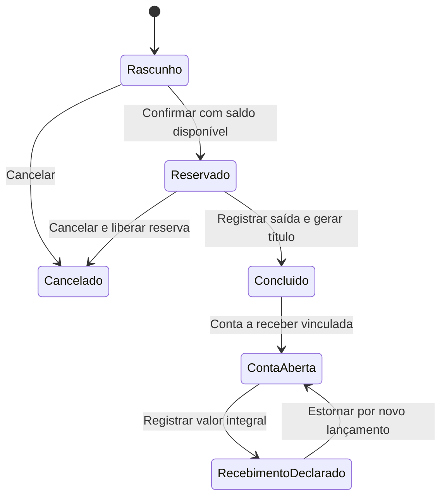

# Pedido, reserva e conta a receber

## Fluxo implementado

As telas de pedidos e contas a receber usam API Rust, PostgreSQL e BFF
autenticado. A migração registra as permissões de consulta e gestão separadas
para vendas e recebíveis. Não concede automaticamente novos direitos aos usuários.

`sales.orders.manage` autoriza a conclusão comercial e a criação do título
vinculado ao pedido, como efeito dessa operação. Não autoriza registrar ou
estornar recebimentos; essas ações exigem `finance.receivables.manage` e consulta.

## Contrato comercial inicial

O pedido contém cliente ativo, vencimento e de 1 a 100 produtos ativos distintos.
O servidor obtém os preços do catálogo e armazena as descrições, unidades, preços
e identificação do cliente como snapshots. O consumidor não envia preços nem
total final. Uma mudança posterior no preço do produto não recalcula o pedido.

O recorte atual trabalha em BRL. Quantidades usam strings com seis casas e preços
usam centavos inteiros. O valor de cada linha é calculado com intermediário
inteiro de 128 bits e arredondamento comercial de meio centavo para cima. O
total é a soma das linhas arredondadas. Não há descontos, frete, juros ou apuração
fiscal nesta regra. Um pedido precisa ter valor comercial positivo.

Rascunhos podem ser editados com revisão e chave de idempotência. É possível
trocar cliente, vencimento, quantidades e composição dos itens enquanto o pedido
estiver em `draft`. Pedidos reservados, concluídos ou cancelados recusam edição.
Editar não reserva nem movimenta estoque e não gera recebível.

Os itens mantidos preservam SKU, descrição, unidade e preço do snapshot anterior;
somente itens novos recebem os dados e preços atuais do catálogo. O total é
recalculado pelo servidor. Remover e reincluir um mesmo produto na mesma gravação
preserva seu snapshot. Se ele foi removido em uma gravação anterior, sua inclusão
posterior constitui um novo item. Não há comando de atualização em massa de preços.

Manter o cliente preserva sua identificação registrada; escolher outro cliente
captura a identificação atual desse novo cadastro. O cliente escolhido precisa
estar ativo e ter papel de cliente, e os produtos precisam estar ativos. Uma
alteração de unidade incompatível no catálogo é recusada. Depois de haver pedido
vinculado, o cadastro de pessoa não permite trocar documento ou tipo.
Os contatos e nomes podem evoluir sem reescrever os snapshots do pedido.

## Disponibilidade e reserva

Reservas são derivadas dos itens de pedidos confirmados. O saldo disponível é o
saldo físico registrado menos essas reservas. Não há um segundo contador de
reservas para sincronizar separadamente.

Todas as escritas desses domínios obtêm o mesmo bloqueio transacional por
empresa, depois revalidam a autorização. Duas confirmações disputando o mesmo
saldo não conseguem reservar além da disponibilidade. Saídas e estornos manuais
de estoque também respeitam a reserva existente.

Cancelar rascunho ou pedido confirmado preserva o histórico e libera sua reserva.
Concluir exige pedido confirmado, cliente/produtos ativos e unidade compatível
com o snapshot. A operação gera as saídas de estoque, o título financeiro, a
auditoria, os eventos de outbox e a resposta idempotente na mesma transação.
Uma falha impede a confirmação de todos esses efeitos.

Vendas coordena a operação por funções internas dos domínios, compartilhando a
transação autorizada. Estoque grava seus saldos e movimentos; financeiro grava
seus títulos. Vendas não escreve diretamente nessas tabelas. Os contratos
internos consultam os itens e a origem comercial no domínio de vendas.

Pedidos concluídos não podem ser cancelados por esse endpoint. Movimentos
gerados pelo pedido não admitem estorno manual avulso: devolução, retorno de
mercadoria e cancelamento fiscal precisam de um fluxo próprio, ainda pendente.

## Recebimentos declarados

A conta nasce da conclusão de um pedido, com seu valor e vencimento. Aceita
declarações parciais ou integrais, em centavos exatos e de valor positivo, até
o saldo restante. Um centavo acima desse saldo é recusado; tolerância numérica
de experimentos não amplia a autorização financeira.

`receivedAmount` é a soma dos recebimentos menos seus estornos, e
`outstandingAmount` é o valor original menos esse recebido líquido. Esses campos
são derivados do histórico preservado, tanto na listagem quanto no detalhe.
A conta permanece `open` enquanto houver saldo, apresentada como recebimento
parcial quando existir valor recebido líquido. `paid` exige saldo exatamente zero.
O campo legado `paymentId`, quando `paid`, identifica o recebimento que fechou
o saldo; ele não representa todos os recebimentos nem limita a escolha do estorno.

O operador informa valor, meio, referência e data. A API não chama banco, adquirente
ou provedor de pagamentos e não movimenta uma conta bancária. `paid` significa
recebimento manual registrado, apresentado na tela como **Recebimento declarado**.

O estorno precisa apontar para um recebimento não estornado daquela conta, informar motivo
e não anteceder a data do recebimento. Ele cria outro lançamento referenciado e
recompõe somente o valor daquele lançamento no saldo restante. A tabela de
lançamentos impede alteração e exclusão. Um mesmo
recebimento não pode receber dois estornos. Depois do estorno pode ser registrado
um novo recebimento, preservando todo o histórico.

Não estão implementados descontos, juros, parcelamento,
contas a pagar, contas bancárias, saldos de caixa ou conciliação externa.

## API e concorrência

| Recurso | Operações |
| --- | --- |
| `/api/v1/orders` | Consulta paginada e criação de rascunho |
| `/api/v1/orders/{id}` | Consulta com itens e ETag; PUT para editar rascunho |
| `/api/v1/orders/{id}/confirm` | Reserva |
| `/api/v1/orders/{id}/cancel` | Cancelamento e liberação |
| `/api/v1/orders/{id}/complete` | Saída e geração de recebível |
| `/api/v1/receivables` | Consulta paginada |
| `/api/v1/receivables/{id}` | Consulta com ETag e histórico de recebimentos |
| `/api/v1/receivables/{id}/payments` | Recebimento parcial ou integral declarado |
| `/api/v1/receivables/{id}/reverse-payment` | Estorno integral de um recebimento escolhido |

Criação exige `Idempotency-Key`. Edição, transições, recebimento e estorno exigem também
`If-Match`. A resposta de um comando confirmado pode ser repetida com a mesma
chave e revisão original, sem repetir seus efeitos. Alterar o contexto do comando
com a mesma chave é conflito. O executor verifica a autorização atual antes de
devolver uma repetição, não apenas na primeira execução.

As telas mantêm o comando de resultado desconhecido em memória e oferecem
repetição explícita. Não recuperam esse estado depois de fechar a aba. Conflitos
de revisão exigem recarregar; a tela financeira pede confirmação antes de
descartar o registro em edição. RLS e chaves estrangeiras compostas preservam
o contexto de empresa no banco.

Um recebimento parcial gera `receivable.payment_recorded`; o que fecha o saldo
gera `receivable.paid`. Estornos geram `receivable.payment_reversed`. Cada comando
usa autorização atual, revisão, chave de idempotência, auditoria e outbox na
mesma transação. A migração `202610270009_receivable_payment_lookup.sql` cria
apenas o índice de consulta por empresa e conta; não reescreve lançamentos antigos.

O editor de pedidos também preserva a alteração recusada e pede confirmação
antes de descartá-la. Repetir um PUT de resultado desconhecido conserva método,
corpo, revisão e chave originais. A resposta repetida corresponde ao comando
original; uma consulta posterior pode apresentar uma revisão mais recente.
Escritas de pedido, itens, auditoria, outbox e comando idempotente são atômicas.

## Isolamento do harness local

`scripts/verify-company.mjs` aceita `ERP_TEST_WEB_ORIGIN`, `ERP_TEST_API_ORIGIN`
e `ERP_TEST_AUTH_ORIGIN`, todos restritos a HTTP em `127.0.0.1`, sem credenciais,
caminho, query ou fragmento. Isso permite usar portas independentes em execuções
simultâneas. Os valores padrão existentes continuam válidos. A configuração
Playwright e os cenários de persistência usam a mesma origem web do harness.
O banco continua exigindo uma instância PostgreSQL local dedicada a testes;
os cenários criam sua própria base, identidade e conta de aplicação sintéticas.

## Limites operacionais

Conclusão comercial não é emissão de NF-e, comprovação de transporte nem entrega
física. Os guards fiscais existentes continuam bloqueando transmissão não
implementada. Outbox persistida também não comprova entrega dos eventos a sistemas
externos. O login de produção ainda depende de provisionamento e validação próprios.

As telas financeiras e comerciais fora deste recorte podem continuar demonstrativas;
não são prova de integração por compartilharem a navegação do ERP.
