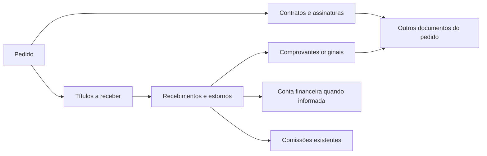

# Pedido, recebimentos, contrato e comprovantes

Levantamento de 13/11/2026, conferido no código `8fc8db7feccf8ccbb6fe80e9ca7799b51071f8e4`. Este documento descreve o que existe e a integração a implementar; não declara a funcionalidade publicada. A disponibilidade de cada capacidade em produção ainda precisa de validação.

## O que o cliente pediu

No áudio de 1 min 7 s, o cliente pede registrar cada recebimento, anexar seu comprovante original e acompanhar tudo dentro do pedido, junto ao contrato. Exemplo:

| Movimento | Recebido acumulado | Saldo devedor |
|---|---:|---:|
| Pedido de R$ 100.000,00 | R$ 0,00 | R$ 100.000,00 |
| Entrada de R$ 50.000,00 | R$ 50.000,00 | R$ 50.000,00 |
| Novo recebimento de R$ 10.000,00 | R$ 60.000,00 | R$ 40.000,00 |
| Recebimento final de R$ 40.000,00 | R$ 100.000,00 | R$ 0,00 |

A inclusão de novos documentos depois da assinatura e a exigência de ICP-Brasil individual são requisitos adicionais informados pelo usuário na conversa. O áudio não especifica ICP-Brasil nem uma regra automática de bloqueio de expedição.

## Responsabilidade por tela e módulo

| Tela ou módulo | Responsabilidade | O que já existe | Integração necessária |
|---|---|---|---|
| Vendas → Pedido | Consulta central da venda | Pedido, negociação, entrada e parcelas previstas, cliente e acesso ao contrato | Mostrar total recebido, saldo real, títulos, recebimentos e documentos; abrir o mesmo comando financeiro a partir do pedido |
| Financeiro → Contas a receber | Registrar e estornar recebimentos; calcular o saldo | Vários recebimentos parciais, quitação, estornos, revisão, idempotência e histórico imutável | Consultar por pedido e associar comprovantes ao recebimento correto; reaproveitar o serviço atual |
| Financeiro → Caixas e bancos | Movimentação da conta financeira escolhida | Recebimento pode criar crédito e estorno pode criar débito na mesma transação | Preservar essa integração e sua rastreabilidade; não criar lançamento avulso duplicado |
| Contratos | Modelo, documento assinado, participantes e evidências | Pedido vinculado, prévia, PDF final, trilha e snapshot imutáveis | Exibir “Outros documentos” vinculados ao mesmo pedido; aceitar novos anexos após assinatura sem alterar o PDF assinado |
| Arquivos / Documentos | Conteúdo privado, metadados e vínculos dos arquivos | Metadados/versionamento em `system_config.files`; arquivos de contratos privados; consulta e arquivamento no gerenciador | Criar armazenamento e API compartilhados de documentos de apoio, upload e download autenticados, vínculo a pedido/título/recebimento e histórico |
| Cadastros → Clientes | Identidade do cliente | Cadastro e vínculo do cliente com pedido e contrato | Consultar os mesmos registros; não cadastrar uma segunda pessoa por causa de um comprovante |
| Cadastros → Formas de pagamento | Meio utilizado | Negociação aceita Pix e cartões; liquidação usa categorias mais amplas | Preservar a forma efetivamente escolhida; alinhar Pix/cartão com os registros financeiros existentes |
| Financeiro → Comissões | Comissão proporcional ao recebido | Recebimento e estorno geram os efeitos correspondentes na mesma transação | Reutilizar os efeitos atuais; anexar um arquivo não pode gerar nova comissão |
| Produção / Logística / Expedição | Acompanhamento da preparação e envio | Operação e estados próprios; não dependem automaticamente da quitação | Consultar a situação financeira quando pertinente; definir separadamente eventual política de liberação |
| Fiscal | Documentação fiscal da operação | Pacote documental consulta NF-e autorizada | Manter o registro de recebimentos e comprovantes disponível antes de existir NF-e; não emitir nota ao anexar um arquivo |

## Uma origem para cada informação

O pedido é o ponto de consulta. O Financeiro continua sendo proprietário dos recebimentos e do saldo. Contratos preserva seus documentos assinados. Documentos armazena cada comprovante uma vez e permite sua consulta pelos vínculos autorizados.

Um pagamento pode ter vários comprovantes; anexar outro arquivo ao recebimento existente não registra o valor novamente. Um pedido pode ter vários títulos e contratos; seu resumo deve considerar todos os títulos válidos, não somente o primeiro.

## Fluxo proposto na tela do pedido

1. **Resumo financeiro:** total do pedido, recebido líquido, saldo devedor e situação. Condições negociadas continuam identificadas como previstas.
2. **Registrar recebimento:** informar título/parcela, valor, data, forma de pagamento, referência e conta financeira quando aplicável. Oferecer o comprovante no mesmo fluxo.
3. **Histórico de recebimentos:** listar cada valor registrado e seus comprovantes. Estorno preserva a linha e o arquivo original, recompõe o saldo e fica visível.
4. **Documentos:** reunir pedido, contratos e outros documentos. Permitir anexar um comprovante posteriormente, inclusive após a assinatura e a quitação.
5. **Consulta/relatório do pedido:** apresentar os movimentos, saldo e documentos vinculados com os mesmos dados do Financeiro.

Registrar recebimento exige as permissões financeiras atuais. Anexar/consultar documentos deve respeitar as permissões do recurso e a empresa da sessão; acesso a Vendas não concede automaticamente direito de baixa financeira.

## Lacunas comprovadas

- `receivable_payments` já registra o dinheiro; não existe vínculo do comprovante original nessa estrutura/API.
- A listagem de recebíveis aceita paginação, mas não possui filtro `orderId`. O detalhe do pedido não oferece uma projeção consolidada do histórico financeiro.
- “Saldo após entrada negociada” é um cálculo do plano comercial. Não prova que a entrada foi recebida.
- O gerenciador atual de arquivos consulta metadados e baixa conteúdo legado; não é uma API pronta de upload de documentos comerciais.
- `commercial_contract_files` aceita somente prévia, assinado e auditoria. Comprovantes posteriores devem permanecer separados dos bytes assinados.
- O pacote documental atual exige NF-e autorizada e só acrescenta declarações de recebimento geradas em RTF/`.doc` quando todos os títulos estão quitados. Essas declarações não substituem o comprovante bancário original nem cobrem a consulta dos parciais.
- O cadastro negociado distingue Pix/crédito/débito, mas a liquidação atual aceita `cash`, `bank_transfer`, `card`, `other`. É necessário preservar a identificação da forma efetiva sem quebrar o contrato existente.
- A confirmação do checkout cria títulos de entrada e parcelas antes da conclusão. No caminho legado, o título só nasce na conclusão. O recebimento antecipado precisa respeitar essa diferença sem antecipar a saída de estoque.
- A confirmação atual também exige estoque físico disponível para a reserva (`apps/api/src/domains/sales.rs:899`). Assim, o caso do áudio em que a entrada precede a chegada das máquinas exige um fluxo explícito de encomenda/recebimento antecipado. A integração de comprovantes, sozinha, não resolve esse impedimento. É necessário preservar os controles de estoque e congelar a condição comercial que originar os títulos; não usar rascunho editável nem criar saldo de estoque fictício.

## Ordem de implementação

1. Acrescentar consulta financeira consolidada por pedido e vínculos privados dos comprovantes, reutilizando o livro financeiro atual.
2. Integrar o registro de recebimento e os anexos à tela do pedido; manter o Financeiro com a mesma informação.
3. Apresentar os mesmos documentos no contrato, inclusive os acrescentados após assinatura, e na consulta do cliente conforme permissão.
4. Completar o relatório do pedido e a identificação da forma de pagamento.
5. Validar o fluxo completo em ambiente isolado e só então publicar. A exigência ICP-Brasil segue uma frente própria de assinatura e validação criptográfica.

Se “receber e anexar” for uma única confirmação, seus efeitos precisam ser atômicos ou ter uma recuperação explícita: uma falha de upload não pode produzir uma mensagem falsa de operação completa, nem uma repetição duplicar dinheiro. Anexar posteriormente é outra intenção, sem efeitos no saldo.

## Validação necessária

- Executar o exemplo de R$ 100.000,00 → R$ 50.000,00 → R$ 10.000,00 → R$ 40.000,00, incluindo cada arquivo.
- Conferir o mesmo saldo em Pedido, Financeiro e Contrato; incluir pedido com várias parcelas.
- Acrescentar comprovante ao recebimento existente e ao contrato já assinado; conferir que não houve novo recebimento e que o hash do PDF assinado permanece igual.
- Repetir comandos e simular duas gravações concorrentes; não duplicar recebimentos nem exceder o saldo.
- Estornar um recebimento e conferir saldo, conta financeira, comissão e preservação do comprovante.
- Validar permissões, isolamento por empresa, tamanho/tipo do arquivo e downloads privados; manter documentos inacessíveis a usuários sem autorização.
- Conferir o relatório e a interface em celular e desktop.

## Evidências no código

Os caminhos abaixo são relativos à raiz do repositório.

| Evidência | Local |
|---|---|
| Saldo e histórico dos recebíveis | `apps/api/src/domains/finance.rs:66` e `:114` |
| Serviço compartilhado de baixa/estorno | `apps/api/src/domains/settlements.rs:115` e `:225` |
| Títulos de entrada e parcelas | `apps/api/src/domains/sales/checkout.rs:296` e `:334` |
| Comissão proporcional ao recebido | `apps/api/src/domains/commissions.rs:146` e `:207` |
| Tela financeira atual | `apps/web/src/features/finance/receivables.tsx:68` |
| Saldo negociado no pedido | `apps/web/src/features/sales/order-detail-commercial.tsx:119` |
| Integridade do contrato e tipos de arquivo | `migrations/202610290001_commercial_contracts.sql:35` e `:60` |
| Catálogo de arquivos atual | `apps/api/src/platform/files.rs:80` e `:204`; `migrations/202611040002_system_configuration.sql:6` |
| Pacote documental e quitação integral | `apps/api/src/domains/contracts/package.rs:130`, `:190` e `:268` |
| Proteções do BFF de contratos | `apps/web/src/server/bff/contracts-proxy.ts:15` |
| Testes de parciais, estornos, concorrência e rollback | `apps/api/src/http/operations_tests.rs:313`, `:485` e `:549` |
| Teste de parcelas sem duplicação na conclusão | `apps/api/src/http/sales_checkout_tests.rs:131` |

Os testes existentes foram identificados na auditoria; isso não equivale a afirmar que a integração nova já está implementada ou que esses cenários foram homologados em produção.
